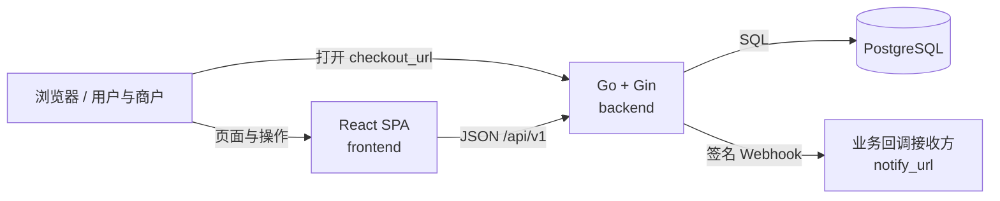
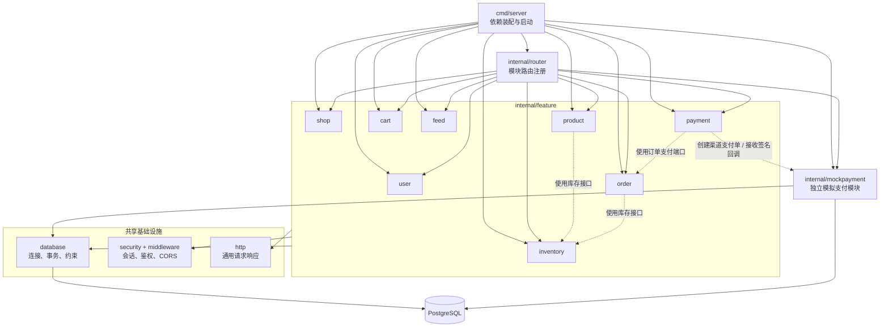
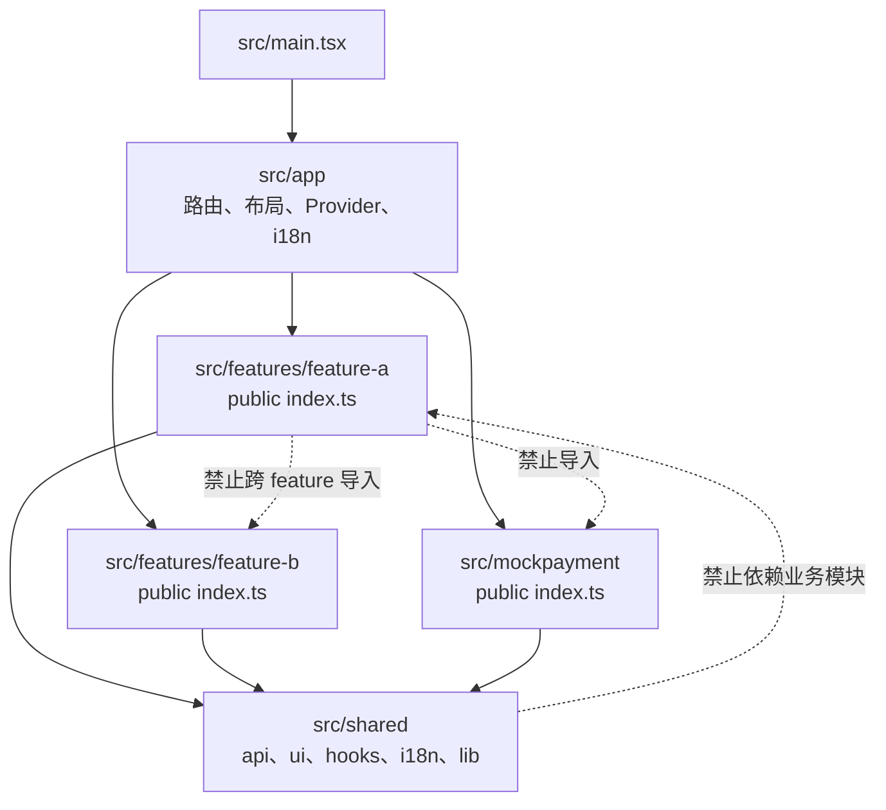
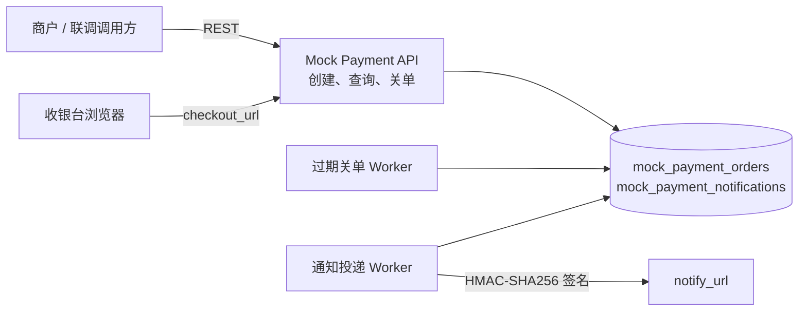

# 宏观架构

本文只描述系统边界、依赖方向和主要运行链路，不展开接口字段、状态机细节或单个模块的实现。

## 系统上下文

- 当前部署形态是一个前端 SPA、一个 Go API 进程和一个 PostgreSQL 数据库。
- 用户端、商户端和模拟支付控制台共用同一套前端应用，但在代码层按模块隔离。
- 模拟支付模块与主应用同进程、同端口部署，通过 `/mockpay` 路由命名空间隔离；业务 API 保持 `/api/v1`。外部接入边界仍是 HTTP，它不依赖业务 feature。

## 后端

- 后端采用 DDD + Clean Architecture 风格的模块化单体。
- 每个 feature 自包含 `controller`、`service`、`repository`、`model`、`dto` 和 `module.go`；调用方向为 Controller → Service → Repository。
- feature 之间不直接访问对方的 repository。product、order 通过 inventory 暴露的接口协作；payment 通过 order 暴露的 `paymentport.Lifecycle` 锁定订单并完成支付结算。
- `mockpayment` 拥有自己的 handler、service、repository、model 和 dto，不引用任何业务 feature。
- `payment` 拥有业务支付单；它只通过 HTTP 调用 mockpayment 创建渠道支付会话，并通过签名回调接收支付结果。
- `payment` 与 `mockpayment` 不互相 import。二者只通过网络交互；回调验签算法放在中立的 `internal/webhooksig`。
- `module.go` 是各模块的装配入口，`cmd/server` 是全局 composition root，`internal/router` 只负责挂载路由。

## 前端

- `src/app` 是前端 composition root，只负责路由、Provider、布局和全局配置。
- `src/features` 是按业务能力组织的垂直切片，模块内部按 `ui`、`model`、`api` 分层，并通过各自的 `index.ts` 暴露公共入口。
- `src/mockpayment` 与 `src/features` 同级，只依赖 `src/shared`，业务 feature 不依赖它。
- `src/shared` 只提供通用基础能力，不反向依赖 app、feature 或 mockpayment。
- 上述依赖方向由 `frontend/.dependency-cruiser.cjs` 和 `npm run lint:architecture` 强制检查。

## 模拟支付边界

- 支付状态、回调 outbox、重试和超时关闭都封装在 `internal/mockpayment` 内。
- 回调通过独立后台 worker 投递；重试过程复用同一事件 ID，达到上限后进入 `exhausted`。
- 模拟支付表与业务表没有外键关系；模块与主 API 共用进程、端口和数据库，不单独部署。
- 收银台由后端提供，前端控制台不绕过收银台直接标记支付成功。

## 数据与边界约束

- 所有模块共用一个 PostgreSQL 数据库连接池，但各模块只操作自己的 repository 和表。
- 数据库结构通过 `backend/migrations` 顺序迁移；模拟支付使用独立的 `mock_payment_orders`、`mock_payment_notifications`。
- 业务 feature 与模拟支付之间没有共享领域模型或业务代码，只通过 HTTP API 和签名回调交互。业务支付状态保存在 `payments`，不复制渠道内部状态。
- 后端架构测试禁止 `internal/feature` 与 `internal/mockpayment` 互相导入，网络边界不能靠约定维持。
- 开发环境中 Vite 代理 `/api`、`/mockpay/api` 与 `/mockpay/checkout` 到 Go 后端，避免 MockPay 控制台 SPA 路由与后端路径冲突。
- 当前不引入微服务、消息队列或跨库事务；后台任务随 API 进程启动和停止。
- 支付 E2E 位于 `backend/internal/e2e`，通过真实 HTTP 和数据库验证下单、支付、回调与结算；该测试只作为组合根级验证，不引入生产依赖。

具体支付接口、状态机和回调协议见 [docs/mock-payment.md](docs/mock-payment.md)。
