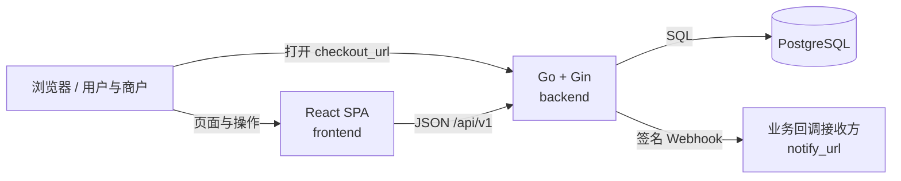
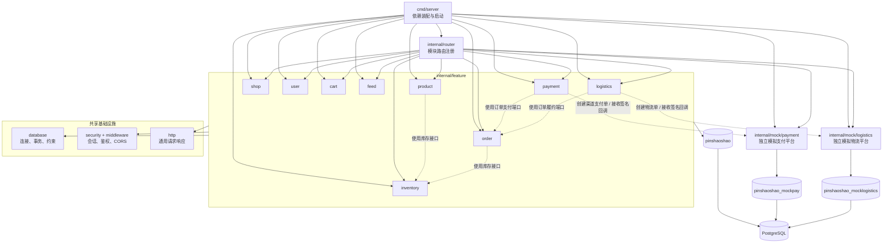
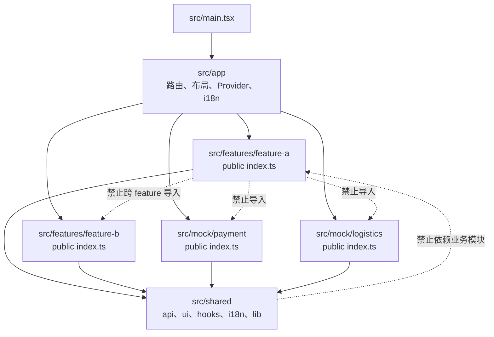
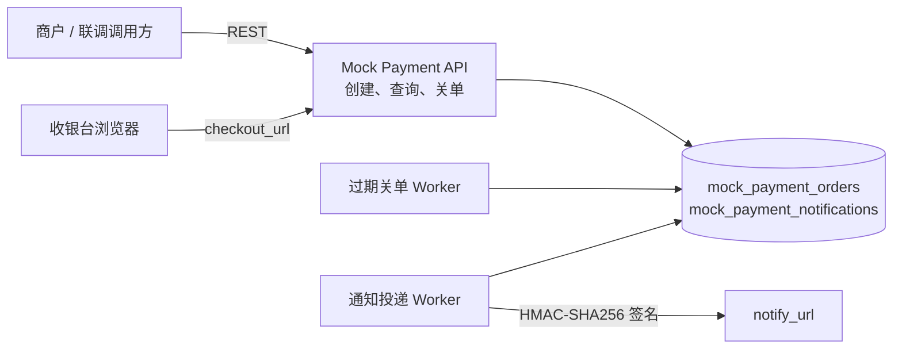
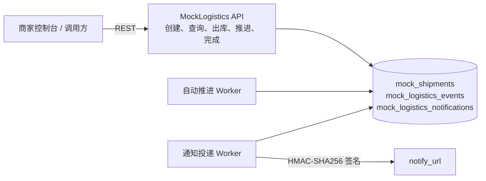

# 宏观架构

本文只描述系统边界、依赖方向和主要运行链路，不展开接口字段、状态机细节或单个模块的实现。

## 系统上下文

- 当前部署形态是一个前端 SPA、一个 Go API 进程和一个 PostgreSQL 服务；服务内有 `pinshaoshao`、`pinshaoshao_mockpay`、`pinshaoshao_mocklogistics` 三个逻辑数据库。
- 用户端、商户端和模拟支付控制台共用同一套前端应用，但在代码层按模块隔离。
- 模拟支付和模拟物流与主应用同进程、同端口部署，分别通过 `/mockpay`、`/mocklogistics` 路由命名空间隔离；业务 API 保持 `/api/v1`。二者各自使用独立连接池、逻辑数据库和 Bearer Session，不依赖主项目用户库或 Session 实现。

## 后端

- 后端采用 DDD + Clean Architecture 风格的模块化单体。
- 每个 feature 自包含 `controller`、`service`、`repository`、`model`、`dto` 和 `module.go`；调用方向为 Controller → Service → Repository。
- feature 之间不直接访问对方的 repository。product、order 通过 inventory 暴露的接口协作；payment 通过 order 暴露的 `paymentport.Lifecycle` 锁定订单并完成支付结算；logistics 通过 `shippingport.Lifecycle` 发货、扣减冻结库存并完成签收。
- `internal/mock/payment` 与 `internal/mock/logistics` 各自拥有 handler、service、repository、model 和 dto，不引用任何业务 feature。
- `internal/mock/auth` 为两个 Mock 平台提供独立的账号、Argon2id 密码校验、随机 Session 和 Bearer 中间件；它不导入业务用户、Session 或 Gateway 实现。
- `payment` 拥有业务支付单；它只通过 HTTP 调用模拟支付平台创建渠道支付会话，并通过签名回调接收支付结果。
- 业务 feature 与 `internal/mock` 不互相 import。支付业务与模拟支付、物流业务与模拟物流都只通过网络交互；回调验签算法放在中立的 `internal/webhooksig`。业务物流记录发货单与轨迹，模拟物流负责承运状态机、出库动作和回调投递。
- `module.go` 是各模块的装配入口，`cmd/server` 是全局 composition root，`internal/router` 只负责挂载路由。

## 前端

- `src/app` 是前端 composition root，只负责路由、Provider、布局和全局配置。
- `src/features` 是按业务能力组织的垂直切片，模块内部按 `ui`、`model`、`api` 分层，并通过各自的 `index.ts` 暴露公共入口。
- 物流切片同时服务买家订单详情、物流详情和商户发货页面；跨 feature 的组合只发生在 `src/app`。
- `src/mock/payment` 与 `src/mock/logistics` 统一放在 `src/mock` 下，复用 `src/mock/auth` 的独立会话外壳，并只依赖 `src/shared` 的基础能力；业务 feature 不依赖它们。
- `src/shared` 只提供通用基础能力，不反向依赖 app、feature 或 mock 模块。
- 上述依赖方向由 `frontend/.dependency-cruiser.cjs` 和 `npm run lint:architecture` 强制检查。

## 模拟支付边界

- 支付状态、回调 outbox、重试和超时关闭都封装在 `internal/mock/payment` 内。
- 回调通过独立后台 worker 投递；重试过程复用同一事件 ID，达到上限后进入 `exhausted`。
- 模拟支付表与业务表没有外键关系；模块与主 API 共用进程和端口，但使用独立数据库、连接池与 Session。
- 运营 API 使用环境变量引导的独立账号登录。业务支付 Gateway 缓存 Bearer token，在 `401` 后刷新并重试一次；收银台只依赖 `paymentNo` 能力凭证。
- 收银台由后端提供，前端控制台不绕过收银台直接标记支付成功。

## 数据与边界约束

- 主业务、MockPay 和 MockLogistics 各有一个 PostgreSQL 连接池，启动时校验三个 `current_database()` 互不相同。
- 主业务迁移位于 `backend/migrations`，Mock 迁移分别位于 `backend/migrations/mockpay` 与 `backend/migrations/mocklogistics`。
- 业务 feature 与模拟平台之间没有共享领域模型或业务代码，只通过 HTTP API 和签名回调交互。业务支付状态保存在 `payments`，业务物流状态保存在 `shipments`、`shipment_events`，不复制渠道内部状态。
- 后端架构测试禁止 `internal/feature` 与 `internal/mock` 互相导入，也禁止模拟支付与模拟物流互相导入。
- 开发环境中 Vite 代理 `/api`、`/mockpay/api`、`/mockpay/checkout` 与 `/mocklogistics/api` 到 Go 后端，避免模拟控制台 SPA 路由与后端路径冲突。
- 当前不引入微服务、消息队列或跨库事务；后台任务随 API 进程启动和停止。
- 支付 E2E 位于 `backend/internal/e2e`，通过真实 HTTP 和数据库验证下单、支付、回调与结算；该测试只作为组合根级验证，不引入生产依赖。

## 模拟物流边界

- 物流状态机、轨迹事件、回调 outbox 和重试全部封装在 `internal/mock/logistics`。
- 商家必须先确认出库，之后按可配置的总配送时长自动完成揽收、转运、派送和签收；手动推进与签收仍可用。
- 模拟数据由 `gofakeit` 生成，状态和时间戳仍由显式状态机控制；自动推进 worker 只按计划触发同一状态机。
- 业务 `internal/feature/logistics` 通过 HTTP 创建物流单并立即出库；签名回调写入业务发货单轨迹，并在签收时完成订单。
- 业务发货单保存在 `shipments`、`shipment_events`，与模拟平台表没有外键关系。

具体支付接口、状态机和回调协议见 [docs/mock-payment.md](docs/mock-payment.md)，业务支付见 [docs/payment.md](docs/payment.md)，业务物流见 [docs/logistics.md](docs/logistics.md)，模拟物流接口见 [docs/mock-logistics.md](docs/mock-logistics.md)。
