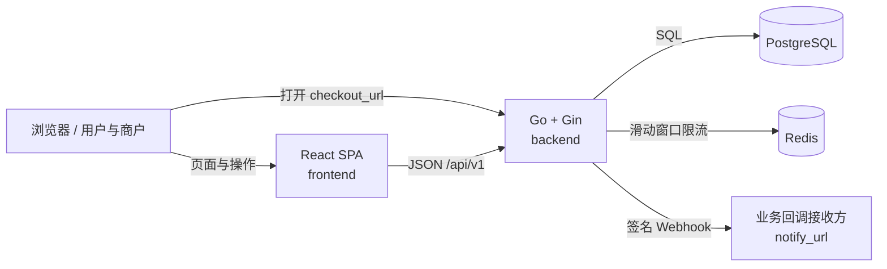
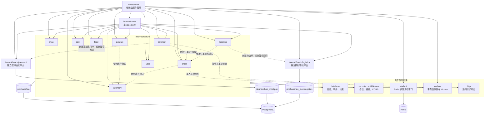
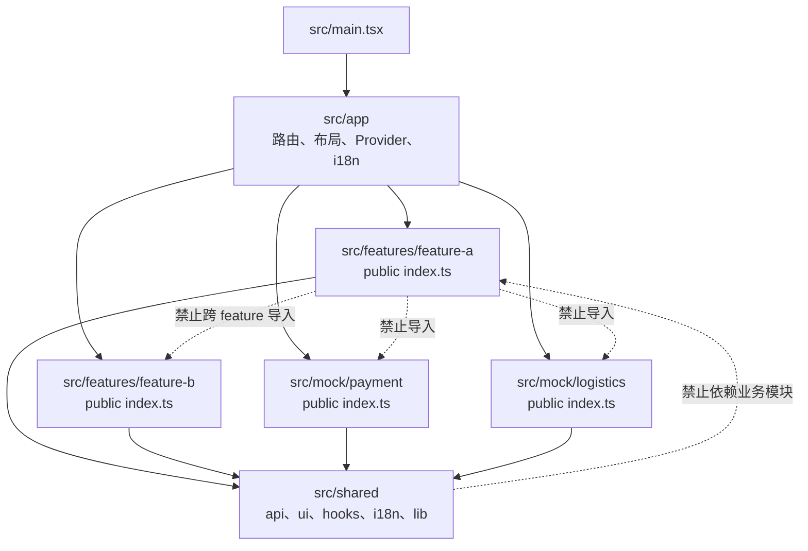

# 宏观架构

本文只描述系统边界、依赖方向和主要运行链路，不展开接口字段、状态机细节或单个模块的实现。

## 系统上下文

- 当前部署形态是一个前端 SPA、一个 Go API 进程、一个 PostgreSQL 服务和一个 Redis 服务；PostgreSQL 内有 `pinshaoshao`、`pinshaoshao_mockpay`、`pinshaoshao_mocklogistics` 三个逻辑数据库。
- 用户端、商户端和两个模拟平台控制台共用同一套前端应用，但在代码层按模块隔离。
- 模拟支付和模拟物流与主应用同进程、同端口部署，分别通过 `/mockpay`、`/mocklogistics` 路由命名空间隔离；业务 API 保持 `/api/v1`。二者各自使用独立连接池、逻辑数据库和 Bearer Session，不依赖主项目用户库或 Session 实现。

## 后端

- 后端采用 DDD + Clean Architecture 风格的模块化单体。
- 每个 feature 自包含 `controller`、`service`、`repository`、`model`、`dto` 和 `module.go`；调用方向为 Controller → Service → Repository。
- feature 之间不直接访问对方的 repository。product、order 通过 inventory 暴露的接口协作；payment 通过 order 暴露的 `paymentport.Lifecycle` 锁定订单并完成支付结算；logistics 通过 `shippingport.Lifecycle` 发货、扣减冻结库存并完成签收。
- `internal/mock/payment` 与 `internal/mock/logistics` 各自拥有 handler、service、repository、model 和 dto，不引用任何业务 feature。
- `internal/mock/auth` 为两个 Mock 平台提供独立的账号、Argon2id 密码校验、随机 Session 和 Bearer 中间件；它不导入业务用户、Session 或 Gateway 实现。
- `payment` 拥有业务支付单；它只通过 HTTP 调用模拟支付平台创建渠道支付会话，并通过签名回调接收支付结果。订单取消与支付单关闭在同一事务内写入 outbox，渠道关单由进程内 worker 异步完成。
- 业务 feature 与 `internal/mock` 不互相 import。支付业务与模拟支付、物流业务与模拟物流都只通过网络交互；回调验签算法放在中立的 `internal/webhooksig`。业务物流记录发货单与轨迹，模拟物流负责承运状态机、出库动作和回调投递。
- `module.go` 是各模块的装配入口，`cmd/server` 是全局 composition root，`internal/router` 只负责挂载路由。

## 前端

- `src/app` 是前端 composition root，只负责路由、Provider、布局和全局配置。
- `src/features` 是按业务能力组织的垂直切片，模块内部按 `ui`、`model`、`api` 分层，并通过各自的 `index.ts` 暴露公共入口。
- 物流切片同时服务买家订单详情、物流详情和商户发货页面；跨 feature 的组合只发生在 `src/app`。
- `src/mock/payment` 与 `src/mock/logistics` 统一放在 `src/mock` 下，复用 `src/mock/auth` 的独立会话外壳，并只依赖 `src/shared` 的基础能力；业务 feature 不依赖它们。
- `src/shared` 只提供通用基础能力，不反向依赖 app、feature 或 mock 模块。
- 上述依赖方向由 `frontend/.dependency-cruiser.cjs` 强制检查。

## Mock 平台边界

- MockPay 与 MockLogistics 和主 API 共用进程与端口，但各自使用独立逻辑数据库、连接池和 Bearer Session；模拟表与业务表没有外键关系。
- MockPay 封装支付状态机、过期关单、回调 outbox 与重试；MockLogistics 封装承运状态机、自动推进、回调 outbox 与重试。
- 业务支付和物流 Gateway 只通过 HTTP 调用 Mock 平台，缓存 Bearer token，并在 `401` 后刷新重试一次。
- 收银台只依赖 `paymentNo` 能力凭证；业务 feature 与 Mock 不互相 import，签名算法共享中立的 `internal/webhooksig`。
- 状态机、接口与协议分别见 [docs/payment.md](docs/payment.md)、[docs/mock-payment.md](docs/mock-payment.md)、[docs/logistics.md](docs/logistics.md) 与 [docs/mock-logistics.md](docs/mock-logistics.md)。

## 数据与边界约束

- 主业务、MockPay 和 MockLogistics 各有一个 PostgreSQL 连接池，启动时校验三个 `current_database()` 互不相同。
- Redis 只保存短生命周期限流窗口，不作为业务数据或 Session 的事实来源。
- HTTP 访问日志通过有界队列异步写入 `slog`；输出阻塞时不占用请求 goroutine，队列溢出会产生丢弃计数。
- 业务 feature 与模拟平台之间没有共享领域模型或业务代码，只通过 HTTP API 和签名回调交互。业务支付状态保存在 `payments`，业务物流状态保存在 `shipments`、`shipment_events`，不复制渠道内部状态。
- 业务取消订单、关闭支付单和写入 `outbox_events` 在同一事务提交；渠道关单由进程内 worker 异步投递并可幂等重试。
- 当前不引入微服务、外部消息队列或跨库事务；过期、自动推进、outbox 和通知 worker 都随 API 进程启动和停止。

`/api/` 请求通过 Redis 执行全站总量、未认证 IP、单路由和用户/商户主体滑动窗口限流，配置与故障策略见 [docs/rate-limiting.md](docs/rate-limiting.md)。
