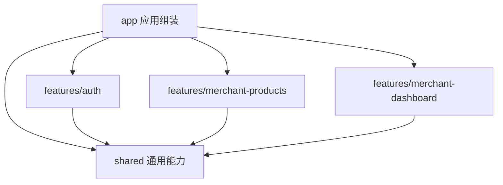

# Frontend Architecture

状态：已迁移。采用下述目录与依赖约束；运行时验证使用模拟 HTTP 响应，不替代连接真实后端的端到端验收。

## 1. 目标与迁移前的问题

采用 **Feature-Based + 模块内部技术分层 + 单向依赖约束**：

- 顶层以 `app / features / shared` 区分应用组装、业务能力与通用能力。
- 一个业务的页面、组件、状态、校验、请求和类型放在同一个 Feature 中。
- Feature 内部采用 `ui → model → api`，所有层都可以使用本模块的纯类型和允许的 `shared` 能力。
- Feature 之间禁止直接导入，由 `app` 组合，使用参数和回调连接。
- 使用依赖图检查工具在 CI 中验证边界，不能只靠目录命名和评审约定。

当前项目使用 React、React Router、TanStack Query、Axios、React Hook Form、Zod、i18next 和 shadcn/Base UI，继续使用现有技术栈。

| 当前组织方式 | 具体问题 |
| --- | --- |
| `pages/merchant-console`、`components/merchant-console`、`merchant-console`、`api/merchant-console.ts` | 同一业务分散在四处，修改商品功能需要跨多个顶层目录 |
| `api/merchant-console.ts` | 仪表盘、店铺资料、商品、分类和 SKU 的请求与类型集中在一个文件 |
| `pages/merchant-console/*.tsx` | 页面直接创建 Query，混合请求编排、状态处理与视图 |
| 商品和 SKU 表单组件 | Zod 校验、数据转换、Mutation 调用与 JSX 混在一起 |
| `merchant-console/mutations.ts` | 商品操作同时知道商品、分类和仪表盘的缓存结构 |
| `auth/merchant/provider.tsx` | 认证模块直接访问全局 QueryClient，承担应用缓存清理职责 |
| `components`、`hooks`、`lib` | 通用能力与业务能力混放，例如全局 hooks 中的 `useMerchantSession` |

本轮保持现有 URL、API 协议、界面、文案、表单规则、会话存储键和缓存更新行为。目录整理不扩展为功能开发。

## 2. Feature 划分

按当前已存在的业务能力划分三个 Feature：

| Feature | 负责 | 边界说明 |
| --- | --- | --- |
| `auth` | 用户与商户的登录、注册、退出、会话恢复、认证表单和错误说明 | 两种身份保留独立的 Context、Provider、存储键与请求；共用现有认证校验和认证布局 |
| `merchant-products` | 商品列表、详情、上下架、编辑、删除、分类选项和 SKU 管理 | 当前分类仅作为商品的查询与编辑依赖；SKU 依附商品，共同保留在本模块 |
| `merchant-dashboard` | 商户统计概览与店铺资料卡片 | 当前店铺资料只有概览中的读取与展示，先归这里 |

首页目前只有站点外壳，放在 `app/pages`。404、站点 Header/Footer、商户控制台布局、导航、路由守卫也属于 `app`。

导航中尚无实现的分类管理、库存管理、店铺设置不提前创建 Feature 或空目录。

## 3. 目标目录

下面列出有实际代码承接的目录与关键文件，不要求机械地拆成一函数一文件。

```text
frontend/
  src/
    main.tsx
    app/
      app.tsx
      router.tsx
      providers.tsx
      query-client.ts
      i18n.ts
      i18next.d.ts
      styles.css
      merchant-navigation.ts
      layouts/
        root-layout.tsx
        merchant-console-layout.tsx
        site-header.tsx
        site-footer.tsx
      pages/
        home.tsx
        not-found.tsx
      routes/
        merchant-products-route.tsx
        merchant-product-detail-route.tsx
        merchant-dashboard-route.tsx
      locales/
        en/
        zh-CN/
    features/
      auth/
        index.ts
        types.ts
        api/
          user.ts
          merchant.ts
        model/
          user-context.ts
          user-provider.tsx
          merchant-context.ts
          merchant-provider.tsx
          use-merchant-session.ts
          schemas.ts
          user-errors.ts
          merchant-errors.ts
        ui/
          auth-layout.tsx
          auth-error-alert.tsx
          user-menu.tsx
          sign-in-form.tsx
          sign-up-form.tsx
          merchant-sign-in-form.tsx
          merchant-sign-up-form.tsx
          pages/
            sign-in.tsx
            sign-up.tsx
            merchant-sign-in.tsx
            merchant-sign-up.tsx
      merchant-products/
        index.ts
        types.ts
        api/
          products.ts
          categories.ts
          skus.ts
        model/
          queries.ts
          query-keys.ts
          mutations.ts
          product-form.ts
          sku-form.ts
          filters.ts
          errors.ts
        ui/
          products-page.tsx
          product-detail-page.tsx
          product-form-dialog.tsx
          sku-form-dialog.tsx
          product-status-badge.tsx
          query-error.tsx
      merchant-dashboard/
        index.ts
        types.ts
        api/
          dashboard.ts
          shop-profile.ts
        model/
          queries.ts
          query-keys.ts
          errors.ts
        ui/
          dashboard-page.tsx
          stat-card.tsx
          query-error.tsx
    shared/
      api/
        client.ts
        authorized.ts
      ui/
        ...现有 shadcn 组件
        brand-mark.tsx
        language-switcher.tsx
        password-input.tsx
        page-header.tsx
        query-error.tsx
        grid-overlay.tsx
      hooks/
        use-mobile.ts
        use-document-title.ts
      lib/
        utils.ts
        format.ts
      config/
        brand.ts
      i18n/
        instance.ts
        config.ts
  .dependency-cruiser.cjs
```

Story 与被展示组件就近放置，不设全局 stories 目录。仅一个 Feature 使用的组件和工具默认留在该 Feature；共享的实际需求明确后再提取。

## 4. 单向依赖规则

箭头表示允许的源码导入方向。



### 顶层规则

| 来源 | 可以导入 | 禁止导入 |
| --- | --- | --- |
| `main.tsx` | 应用入口、应用初始化与全局样式 | 直接组装业务逻辑 |
| `app` | `app` 内部、Feature 公共入口、`shared` | Feature 内部文件 |
| 某个 Feature | 本 Feature 内部、`shared` | `app`、其他 Feature，包括其公共入口 |
| `shared` | `shared` 内部、第三方库 | `app`、任意 Feature |

禁止通过相对路径、重导出、动态导入或 `import type` 绕过边界。

### Feature 内部规则

```text
ui → model → api
│      │      │
└──────┴──────┴──→ types.ts
└──────┴──────┴──→ 允许的 shared 能力
```

| 层 | 内容 | 依赖约束 |
| --- | --- | --- |
| `ui` | 页面、业务组件、表单渲染、弹窗开关、展示状态 | 使用本模块 `model`、`types.ts` 和通用 UI；不直接调用 `api` 或创建 Query/Mutation |
| `model` | Query hooks/options、Query keys、Mutation、会话状态、表单 schema、业务转换与筛选 | 使用本模块 `api`、`types.ts` 和通用基础能力；不导入业务 UI 或 `shared/ui` |
| `api` | 接口路径、请求参数传递、响应读取 | 使用本模块 `types.ts` 与共享 HTTP/纯工具能力；不导入 `model`、`ui`、React hooks 或 Router |
| `types.ts` | 数据结构、输入结构、Session 与回调契约 | 作为叶子依赖，不导入本模块 `ui/model/api`，不承载运行时逻辑 |

`model` 允许使用 React hooks、Context，以及只提供 Context 的 Provider。它不渲染表单、布局或其他视觉组件。

查询、会话与提交状态放在 `model`；只服务 JSX 的临时交互状态继续就近放在 `ui`，不为弹窗开关单独建立状态管理层。

数据结构放在 `types.ts`，使 `api` 和 `model` 都能引用，避免出现 `model → api → model/types` 的反向依赖。本轮继续使用现有响应字段和类型，不增加无实际转换需求的 DTO/domain 双份模型。

共享层内部也保持方向：UI/hooks 可以依赖纯工具、语言运行时与配置；HTTP 客户端可以依赖配置和纯工具；纯工具、语言运行时与配置不得反向导入 UI 或业务模块。

### 公共入口

- 每个 Feature 用 `index.ts` 显式导出调用方实际需要的页面、会话 hooks/Provider、类型和缓存操作。
- `app` 只能从 `@/features/<feature>` 导入，不深挖 `model`、`ui` 或 `api`。
- Feature 内部使用相对路径，不通过自己的 `index.ts` 导入，避免入口形成循环。
- HTTP 请求函数、表单内部工具和所有内部组件不批量对外导出，不使用 `export *`。
- `shared` 按具体文件导入，例如 `@/shared/ui/button`，不建立汇总所有工具与 UI 的大入口。

## 5. 三处现有耦合的处理

### 5.1 商户会话与业务 Feature

将 `useMerchantSession` 移到 `auth/model`，从 `auth` 公共入口导出。商品和概览模块不导入该 hook。

由 `app/routes` 的适配组件读取会话，再把 `token` 传给业务页面和该页面内部的查询、表单。商品详情的 ID、列表到详情的地址生成函数、返回地址也可由路由适配组件提供。

```tsx
function MerchantProductsRoute() {
  const { token } = useMerchantSession()
  const queryClient = useQueryClient()

  return (
    <MerchantProductsPage
      token={token}
      productHref={merchantConsoleProductPath}
      onCatalogChanged={() => invalidateMerchantDashboard(queryClient)}
    />
  )
}
```

示例中的认证 hook、商品页面、概览缓存操作分别来自三个 Feature 的公共入口，地址函数来自 `app`。详情路由采用同样的连接方式。

商户登录/注册页通过 `redirectTo` 参数接收成功后的目标地址，移除认证表单对 `merchant-console/nav` 的依赖。控制台布局继续在应用层执行登录守卫和跳转。

### 5.2 商品变化与概览缓存

保留当前成功后刷新的范围与等待语义：

| 成功操作 | 商品模块内部负责 | 应用层连接 |
| --- | --- | --- |
| 商品新增、编辑、删除、上下架 | 商品列表、详情、SKU 查询以及分类查询失效 | 调用概览模块导出的 `invalidateMerchantDashboard(queryClient)` |
| SKU 新增、编辑、删除 | 商品列表、详情和 SKU 查询失效 | 同样刷新概览统计 |

商品模块的 Mutation 成功处理先承担自身缓存更新，并调用传入的 `onCatalogChanged`；返回的 Promise 覆盖两部分更新，维持现有 Mutation pending 行为。

商品模块不再持有概览的 Query key。概览模块公开一个缓存失效操作即可，不需要把所有 Query keys 暴露给外部，也不需要事件总线或通用插件机制。

### 5.3 商户会话切换与缓存清理

QueryClient 的创建与默认配置放在 `app/query-client.ts`，通过 `QueryClientProvider` 注入。

`MerchantAuthProvider` 接收一个同步的 `onBeforeSessionChange` 回调；登录、注册、退出时，在当前清理缓存的时间点调用它。`app/providers.tsx` 将 `queryClient.clear()` 传入，保留现有清理范围和时机。

认证 Feature 不再导入全局 QueryClient。通用 HTTP 层只保留错误标准化与现有未授权通知能力，监听、会话动作和导航在应用层连接；本轮不改变 401 处理策略。

## 6. 请求、表单与共享组件的归属

- `api/merchant-console.ts` 按三个商品请求文件和两个概览请求文件拆分；`api/auth.ts` 的用户与商户请求归认证 Feature。
- `useQuery`、Query options 与 key 定义统一收敛到对应 Feature 的 `model`。请求所需 token 显式作为参数，底层 HTTP 客户端不读取业务会话。
- 商品与 SKU 的 schema、默认值构造、规格计算、输入转换放在 `model/product-form.ts`、`model/sku-form.ts`。只有需要复用、独立变化或承载业务规则的部分才从 JSX 中抽出。
- 商品筛选放在商品 `model/filters.ts`；排序、筛选不进入 HTTP 文件，也不进入通用工具目录。
- `AuthLayout`、`AuthErrorAlert`、`UserMenu` 放在认证 Feature。`SiteHeader` 在 `app` 中使用认证模块导出的 `UserMenu` 和会话 hook。
- `ProductStatusBadge` 留在商品 Feature；`StatCard` 和店铺资料卡片留在概览 Feature。
- `PasswordInput`、`PageHeader` 和通用错误展示可放在 `shared/ui`。其中 `QueryError` 改为接收标题、说明、重试文案与回调，不引用 `console` namespace 或商品错误码。
- 具体服务端业务错误到文案的映射归对应 Feature；通用 HTTP 错误类型仍归 `shared/api`。

## 7. i18n、样式与开发配置

现有 i18n 初始化同时承担运行时创建、语言偏好与业务词条装配，需要沿同一方向拆开：

- `shared/i18n/instance.ts` 创建并导出 i18next 实例；`shared/i18n/config.ts` 保留语言选择、持久化与文档语言设置。
- `app/i18n.ts` 负责插件安装、词条注册和初始化；`main.tsx` 在渲染前引入它。
- 本轮保留 `common/home/auth/console` 四个 namespace 和所有 key，八个 JSON 文件集中迁到 `app/locales`，不同时重构翻译结构。
- `shared/lib/format.ts` 依赖共享 i18next 实例读取语言，不反向导入应用初始化文件。
- i18next 的类型扩展放在 `app/i18next.d.ts`，作为应用的编译期资源注册；Feature 使用第三方包的类型，不直接引用应用资源文件。
- 全局 CSS 归应用入口。shadcn 的 `components.json` 同步更新 UI、utils、hooks、components/lib 别名和 CSS 路径，避免之后生成组件回到旧目录。
- Vite 和 TypeScript 继续使用 `@/* → src/*`，不为每个 Feature 新增别名。
- Storybook 的全局装饰器复用应用 Provider 与 i18n 初始化，示例与组件一起迁移。当前 preview 仍引用旧的 `@/lib/auth`，迁移入口引用时一并对齐新公共入口。

## 8. 自动化约束

使用开发依赖 **dependency-cruiser**。继续用 Oxlint 检查代码质量，使用依赖图工具处理路径解析与架构约束。

检查配置读取现有 `tsconfig.app.json` 解析路径，覆盖 `src` 和 `.storybook`。由于当前 dependency-cruiser 的 TypeScript 编译器接口尚不兼容项目的 TypeScript 7，显式使用 `@swc/core` 解析源码，保留类型导入、重导出与动态导入依赖。生产构建仍使用原有 TypeScript 版本。

必须检查：

1. `shared` 不依赖 `app/features`，Feature 不依赖 `app`。
2. 不同 Feature 之间零导入，包括只导入类型。
3. 应用和开发入口访问 Feature 时只能使用公共 `index.ts`。
4. `model` 不依赖 `ui`，`api` 不依赖 `model/ui`，`ui` 不直接依赖 `api`；`types.ts` 不反向导入实现层。
5. Feature 内部不导入自己的公共入口；共享能力不得反向依赖共享 UI。
6. 项目内部无循环依赖、无无法解析的本地导入。
7. 迁移完成后不再出现旧的顶层业务目录或对应别名引用。

公共入口只做导出，按边界门面单独处理；与组件就近放置的 Story 允许导入该组件，`.storybook` 作为应用组装入口访问公共能力。以上均采用明确的路径规则，不开放跨 Feature 的通配豁免。

`npm run lint:architecture` 由现有 `npm run lint` 串联执行，因此 CI 现有 Lint 步骤即可强制约束。新 Feature 目录会自动加入跨 Feature 和内部入口检查规则。迁移时已用临时违规引用验证反向导入、跨 Feature、私有文件访问、内部反向分层和循环依赖等 10 条规则，包含类型重导出、动态导入与相对路径；临时引用已移除。

## 9. 迁移顺序与验收

### 阶段一：应用与通用能力归位

迁移 HTTP 客户端、基础 UI、工具、通用 hooks、品牌与语言运行时到 `shared`；把入口组装、路由、QueryClient、站点/控制台外壳、i18n 初始化放到 `app`。先保留现有业务实现，更新其引用。

### 阶段二：认证闭环归位

把认证 API、会话、schema、错误映射、页面、表单、布局与 UserMenu 迁到 `features/auth`。同时完成应用层缓存清理回调和商户登录跳转参数，建立公共入口。

### 阶段三：商品与概览归位

拆分商户请求文件，迁移两个业务 Feature。将 Query 和表单规则放入 `model`，接上应用路由适配组件及跨模块缓存回调，再删除已经没有内容的旧目录。

### 阶段四：收紧依赖检查并集中验证

补齐 dependency-cruiser 规则、shadcn 别名和 Storybook 入口。迁移期间若存在临时规则豁免，必须限定到具体旧路径，最终全部移除。

完成后集中运行：

```text
npm run lint
npm run build
npm run build-storybook
```

再手工核对现有关键链路：

- 用户与商户登录、注册、刷新恢复会话、退出及原有成功跳转。
- 商户路由守卫、失效会话处理，以及切换商户时的缓存清理。
- 商品筛选、创建、编辑、上下架、删除、详情与 SKU 操作。
- 商品/SKU 修改后，列表、详情、分类数量及概览统计按现有范围刷新。
- 中英文切换、格式化、页面标题、组件 Story 与原有导航地址。

本轮不引入新的状态管理库、请求仓储接口、依赖注入容器或额外的领域分层；验证围绕现有链路与导入约束，不为机械移动新增业务测试。

### 已完成的针对性验证

- `npm run lint`、`npm run build`、`npm run build-storybook` 均通过。依赖检查覆盖 160 个模块、516 条依赖；保留原有基础组件的四条 Oxlint 警告与构建包体积提示。
- 与迁移前源码核对，43 个组件的 JSX 静态类名与文本、八个语言资源、18 个 API 函数体保持一致，19 个 Story 全部保留。
- 用迁移前的源码作为对照，验证 245 组商品/SKU schema 输入的结果与错误一致，并核对 SKU 初始规格和输入转换。
- 通过模拟 HTTP 响应执行六种商品/SKU Mutation，验证商品列表、详情、SKU、分类及概览的缓存失效范围，确认等待跨模块回调结束后 Mutation 才完成。
- 验证商户登录、注册、退出、会话恢复以及缓存清理回调发生在持久化更新之前。
- 以上行为检查使用临时验证程序，完成后移除，不进入正常业务代码。
