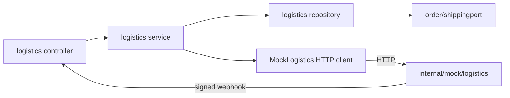
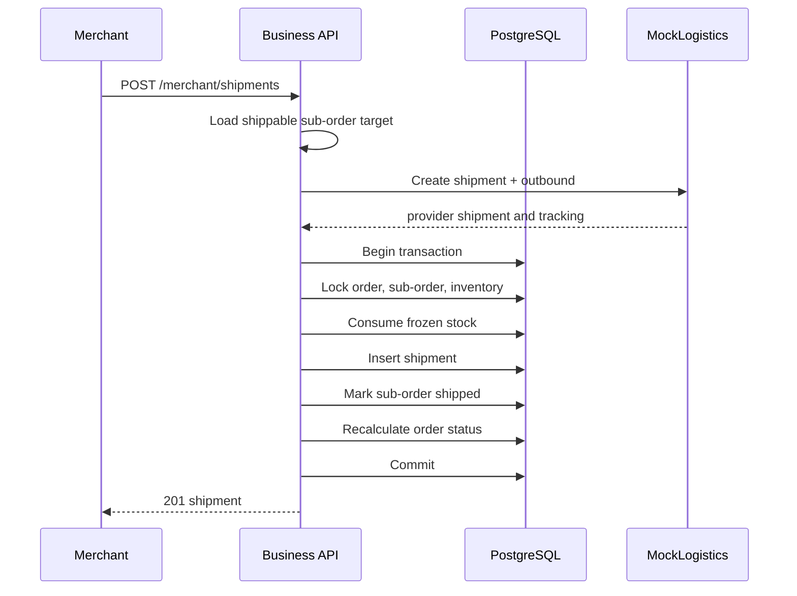

# 业务物流

`internal/feature/logistics` 是商城侧的物流 feature，拥有发货单与物流轨迹。承运、轨迹推进和回调重试仍由独立的 `internal/mock/logistics` 平台提供，双方只通过 HTTP API 与签名回调通信。

模拟物流平台本身见 [mock-logistics.md](mock-logistics.md)。

## 职责边界

- `logistics` 拥有 `shipments` 与 `shipment_events`。
- 每个子订单最多一张业务发货单；重复发货请求返回已有发货单。
- 商家发货时，业务服务调用 MockLogistics 创建物流单并立即确认出库。
- 发货单落库、子订单变为 `shipped`、父订单重新计算状态、冻结库存转售出，在同一个数据库事务内完成。
- 签名回调只更新轨迹和发货单状态；签收时在同一事务内完成子订单与父订单。
- `logistics` 不直接访问订单表或库存表，只通过 `order/shippingport` 暴露的履约端口协作。
- `order` 不依赖 `logistics`；组合根把 `Module.ShippingLifecycle()` 注入物流模块。

## 依赖方向



业务物流与模拟物流不互相 import。共享的签名算法位于中立的 `internal/webhooksig`。

## 状态

业务发货单状态：

```text
pending_pickup
  → picked_up
  → in_transit
  → at_transit_hub
  → out_for_delivery
  → delivered
```

子订单与父订单状态：

```text
awaiting_shipment --ship--> shipped --deliver--> completed
```

- 一个父订单中的所有子订单都发货后，父订单为 `shipped`。
- 部分子订单发货时，父订单为 `partially_shipped`。
- 一个父订单中的所有子订单都签收后，父订单为 `completed`。

## 环境变量

| 环境变量 | 必填 | 说明 |
| --- | --- | --- |
| `MOCKLOGISTICS_WEBHOOK_SECRET` | 是 | 与 MockLogistics 共用的回调 HMAC 密钥 |
| `LOGISTICS_PUBLIC_BASE_URL` | 否 | 本服务公开地址；默认回退到 `PAYMENT_PUBLIC_BASE_URL` 或 `http://localhost:$PORT` |
| `LOGISTICS_GATEWAY_BASE_URL` | 否 | MockLogistics origin；默认同公开地址 |
| `LOGISTICS_NOTIFY_URL` | 否 | 回调地址；默认 `$LOGISTICS_PUBLIC_BASE_URL/api/v1/logistics/webhook` |

启动前执行 `backend/migrations/20261124150000_create_shipments.sql`。

## HTTP API

| 方法 | 路径 | 鉴权 | 说明 |
| --- | --- | --- | --- |
| `POST` | `/api/v1/merchant/shipments` | 商户会话 | 为已支付子订单创建并出库发货单 |
| `GET` | `/api/v1/merchant/shipments` | 商户会话 | 分页查询本店发货单 |
| `GET` | `/api/v1/merchant/shipments/:shipmentNo` | 商户会话 | 查询本店发货单与完整轨迹 |
| `GET` | `/api/v1/shipments?order_id=...` | 买家会话 | 查询自己订单的发货单 |
| `GET` | `/api/v1/shipments/:shipmentNo` | 买家会话 | 查询自己的发货单与完整轨迹 |
| `POST` | `/api/v1/logistics/webhook` | 签名 | 接收 MockLogistics 状态回调 |

发货：

```http
POST /api/v1/merchant/shipments
Authorization: Bearer <merchant-token>
Content-Type: application/json

{"sub_order_id": 12, "carrier": "顺丰速运"}
```

首次成功返回 `201`，重复请求返回已有发货单和 `200`。`carrier` 可省略，由物流平台选择。

商户列表支持 `page`、`page_size` 和 `status`。买家按订单查询返回该订单下的全部发货单，不返回其他买家的数据。

## 发货流程



调用物流平台发生在本地事务之前。物流平台以业务发货单号作为 `merchant_order_no` 幂等键；如果本地事务失败，商家重试会复用平台已有的物流单。

发货事务与回调事务统一先锁定订单，再锁定发货单。重复发货不会重新插入发货单，避免与签收回调并发时形成锁环。

## 回调与幂等

回调头：

- `X-MockLogistics-Event-Id`
- `X-MockLogistics-Event-Type`
- `X-MockLogistics-Timestamp`
- `X-MockLogistics-Signature`

签名原文为 `timestamp + "." + raw_request_body`，默认允许 5 分钟时间偏差。

字段映射：

- `data.merchant_order_no` 是业务发货单号。
- `data.shipment_no` 是物流平台发货单号。
- `data.tracking_no` 是承运运单号。

处理规则：

- 事件 ID 重复时直接返回当前发货单，不重复写轨迹。
- 同一发货单的 sequence 冲突但事件 ID 不同，整笔回调拒绝。
- 乱序到达的旧事件可以写入轨迹，但不会回退当前状态或清空签收时间。
- 签收事件与子订单完成在同一事务内提交。
- 物流平台在业务发货单落库前投递回调时可能收到 `404`；平台按自身退避策略重试，业务单落库后即可成功。

## 数据库

- `shipments`：发货单、买卖双方归属、物流平台单号、运单号、承运商、当前状态、收寄信息与时间戳。
- `shipment_events`：按发货单和 sequence 唯一的签收前轨迹。
- 两张表属于业务库，与 `mock_shipments` 等模拟平台表没有外键关系。

## 前端

| 路径 | 说明 |
| --- | --- |
| `/orders/:orderID` | 买家订单详情内的子订单物流摘要 |
| `/shipments/:shipmentNo` | 买家物流详情与完整轨迹 |
| `/merchant/orders` | 待发货子订单的行内发货入口 |
| `/merchant/logistics` | 商户发货单列表、状态筛选与新建发货 |
| `/merchant/logistics/:shipmentNo` | 商户物流详情与完整轨迹 |

前端代码位于 `frontend/src/features/logistics`。`order`、`merchant-orders` 不导入物流 feature；买家子订单插槽和商户订单行操作由 `src/app` 组合。

## 测试

```bash
cd backend
go test ./internal/feature/logistics/... ./internal/router ./internal/architecture
go test -tags integration ./internal/feature/logistics/repository
go test -tags integration ./internal/e2e -run "TestPaymentHTTPFlow|TestLogisticsHTTPFlow"

cd ../frontend
npm run test -- src/features/logistics
npm run lint
npm run build
```

仓库集成测试覆盖发货扣减冻结库存、订单状态推进、重复发货、重复回调、乱序轨迹和签收完成；E2E 测试覆盖下单支付、物流平台推进、签名回调与订单完成。
